# CloClo Desktop Widget

A small floating widget for Windows with a Keeper or Lady Keeper avatar,
local time and battery information, weather, reminders and quick tools. By
default it stays above other windows near your taskbar clock. Windows doesn't
allow an app to draw directly on the system clock itself, so CloClo sits just
above the taskbar instead.

## Screenshots

These examples show the Lady Keeper avatar in everyday mode and briefly posing
with a camera for a screenshot notification. The outfit, weather, location and
visible icons depend on your settings and current conditions.

| Everyday widget | Screenshot notification pose | Actions pose |
|---|---|---|
| 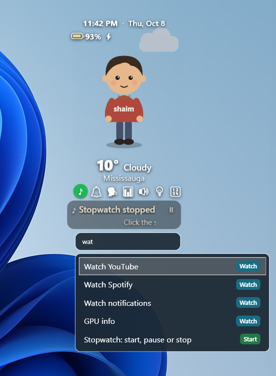 | 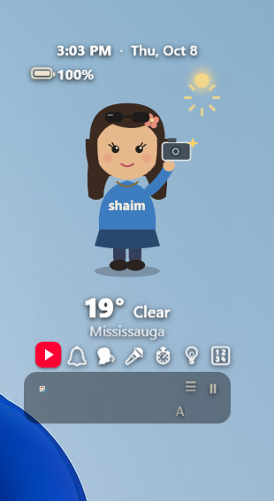 | 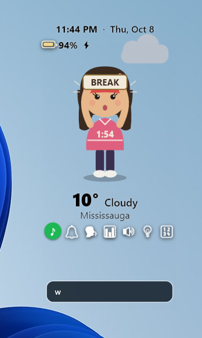 |

## Project layout

- `src/Views/` contains the WPF windows, avatar and search interface.
- `src/Services/` contains weather, speech, reminders, calculator, Sudoku and
  other feature logic.
- `src/Platform/` contains Windows integration and process safeguards.
- `installer/` contains the WiX setup projects; `Assets/` contains the app icon.
- `docs/screenshots/`, `docs/security/` and `docs/notes/` hold visual and
  reference material, including the [security checklist](docs/security/SECURITY-CHECKLIST.md).
- `scripts/` contains the double-click `.cmd` launchers and the PowerShell
  build, install, signing and source-check scripts.
- `config/` contains the app manifest. The project file, `nuget.config` and
  Git configuration files remain at the top level so their tools find them.

## Getting started

1. **Double-click `scripts/Install-CloClo.cmd`** from the project folder — as
   yourself, not with "Run as administrator". It builds, signs and installs
   CloClo the recommended way:
   - into `C:\Program Files\CloClo`, where no other program running as you can
     change it (one administrator prompt, for the copy only);
   - signed with your newest CloClo certificate whose key is protected — if
     you have none, it offers to create one, and it never signs with an
     unprotected key;
   - with Start Menu and desktop shortcuts, and listed in **Settings → Apps →
     Installed apps**;
   - recording a fingerprint of the source it was built from, for
     `scripts/Check-Source.cmd`.

   Windows may ask you to confirm code signing, then shows the administrator
   prompt for the Program Files copy. The window stays open at the end so you
   can read the result.
2. CloClo starts by itself afterwards; next time, use the Start Menu or
   desktop shortcut. It appears in the bottom-right corner, just above the
   taskbar.
3. Right-click it → **Set location…** to pick your city.

To remove it, double-click `scripts/Uninstall-CloClo.cmd`, or use **Settings → Apps →
Installed apps → CloClo → Uninstall**.

To see whether anything in the project folder changed since the last
install, double-click **`scripts/Check-Source.cmd`** — see
[Checking the source](#checking-the-source).

To choose differently (a per-user install or no signing), run
`scripts/install.ps1` yourself — see [Installing](#installing).

Always start the installed copy, not `publish\CloCloWidget.exe`: every install
empties and rebuilds `publish\`, and a copy running from there gets in the way.

### Requirements

- **To run:** Windows 10 version 2004 or later, or Windows 11, 64-bit. Nothing
  else — the app carries its own .NET runtime.
- **To build:** the [.NET 10 SDK](https://dotnet.microsoft.com/download),
  installed in its standard location (`C:\Program Files\dotnet`) —
  `install.ps1` only runs `dotnet` from there.
- **To sign:** additionally the Windows SDK, which provides `signtool.exe`.

## Features


CloClo shows the time, battery, connection and weather around a small Keeper
or Lady Keeper avatar, with an icon bar of quick tools and a search box
underneath. Everything below is reached from the icon bar, the search box or
the right-click menu.

The screenshots were taken with **Privacy → Hide from screen sharing** turned
off. With it on (the default), screenshots and recordings leave CloClo out —
see [Privacy](#privacy-and-data).

### The widget

- **Drag** anywhere on the widget to move it. It remembers where you leave it.
- **One at a time.** Only one CloClo runs per Windows sign-in. Starting it
  again (shortcut, Start Menu, the exe) doesn't open a second copy - it shows
  the running one, even if it was hidden from the tray, with "CloClo is
  already running".
- **Top line:** the time and date, in Windows' own formats (12- or 24-hour,
  day/month order), e.g. "9:41 PM · Tue, Oct 6". The sky in words sits with
  the temperature: "12° Clear". The battery shows its charge and, when Windows
  provides it, an estimate of time remaining.
- **Location:** see [Setting your location](#setting-your-location) below.
- **Weather** refreshes every 20 minutes from
  [Open-Meteo](https://open-meteo.com) (no API key, no account).
- A **tray icon** (near the clock, in the hidden-icons area) has the same
  menu. Double-click it to show or hide the widget. If the widget is hidden,
  right-click the tray icon and choose **Show widget**, or launch CloClo again.

<br clear="right">

### Setting your location

| Before: Cairo | Right-click → **Set location…** | After: London |
|---|---|---|
|  | 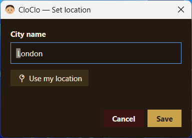 |  |

**Use my location** finds where the PC is now, through Windows' location
service:

| Before: Cairo | Choose **Use my location** | After: the PC's current city |
|---|---|---|
|  | 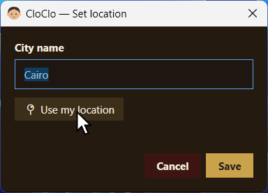 | 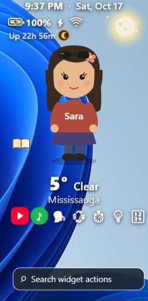 |

Open **Set location…** from the right-click menu or the search box. Type a
city and choose **Save**, or choose **Use my location** and grant Windows'
location permission to use where the PC is now. The dialog closes by itself
once the city is found. The weather, the city under
the temperature and the [prayer times](#prayer-times-and-azan) switch to the
new place straight away. The stored and requested coordinates are rounded to
two decimal places.

### Power, connection and devices

| Hover the battery | Hover the connection icon |
|---|---|
| 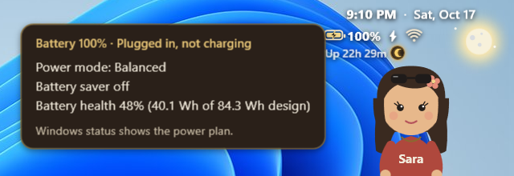 | 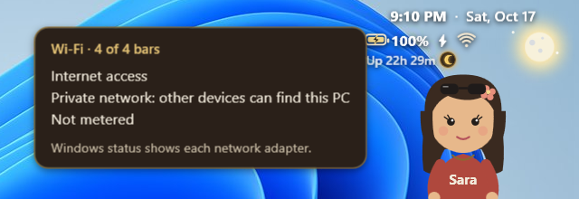 |

- **Power details:** hover the battery for a card with what Windows reports:
  charge and whether it's charging, plugged in or on battery, time left (or
  about how long to full while charging), the charge rate in watts, the
  power mode (Best power efficiency, Balanced or Best performance), battery
  saver, and battery health (full-charge against design capacity, e.g. "48%
  (40.1 Wh of 84.3 Wh design)"). Lines Windows can't report are left out.
  On a PC without a battery, a small plug sits in the battery's place and
  hovering it shows "AC power" with the power mode. It's read when the card
  opens, and screen readers hear the same details as the icon's help text.
- **Internet connection:** a small icon in the top-left column shows how the PC is
  connected, with its own glyph for each: wired (an Ethernet port), Wi-Fi (a
  fan with up to four lit bars), cellular (rising signal bars with its
  generation: 5G, 4G, 3G or 2G), offline (a cloud struck through in red) and
  any other connection, such as a VPN (a globe). Small gold
  badges add "!" when there's limited or no internet, a globe on a public
  network and a gauge when the connection is metered (roaming counts as
  metered). Hover it for the details. Screen readers hear the whole state,
  e.g. "Wi-Fi, 3 of 4 bars, private network, not metered". It comes from
  Windows' own record of the connection, updates when Windows reports a
  change, and sends nothing; network names are never shown. Turn it off with
  **Show internet connection** under right-click → **Privacy**, or search.
- **Bluetooth and headphones:** next to the internet icon, the Bluetooth rune
  shows while Bluetooth is on (bright with a device connected, faint with
  none; hidden while it's off), and a headphones glyph shows while sound
  plays through headphones or a headset (a headset adds a microphone boom).
  Hover either one for the details, e.g. how many devices are connected or
  whether the headphones are on Bluetooth. Screen readers hear "Bluetooth on,
  1 device connected" or "Headset connected over Bluetooth". They follow
  Windows' own radio, Bluetooth and sound-device events, and device names are
  never shown. Headphones plugged into a jack that Windows still calls
  "Speakers" can't be told apart. Turn them off with **Show Bluetooth and
  headphones** under right-click → **Privacy**.
- **Where they sit:** these icons go beside the battery percentage when they
  fit before the sun or moon, or on a row of their own in the top-left
  column otherwise. On a PC without a battery they come first in the column.

### Avatar and weather

| Keeper | Rain | Lady Keeper, snow | Storm | Stretch break |
|---|---|---|---|---|
| 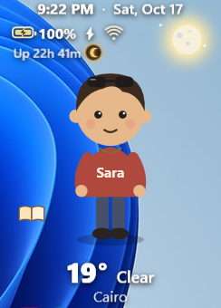 | 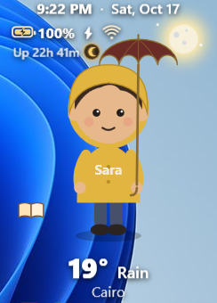 | 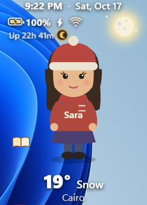 | 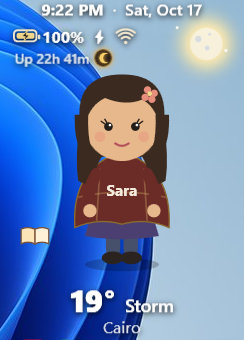 | 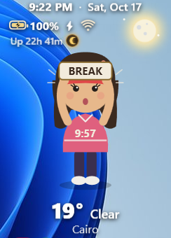 |

Choose Keeper or Lady Keeper and a separate everyday outfit colour for each.
Weather changes the sky and clothing; **Weather** can follow the live forecast
or use a sky you pick. The avatar sleeps after your chosen idle interval and
wears workout clothes during a stretch-break reminder. With the prayer look on
(see [Prayer times and azan](#prayer-times-and-azan)), it wears prayer clothes
at prayer time. The **Motion** menu offers full, gentle and still modes. Time
of day adds small visual details; the clock and weather text adapt to the
desktop background.

### Reminders

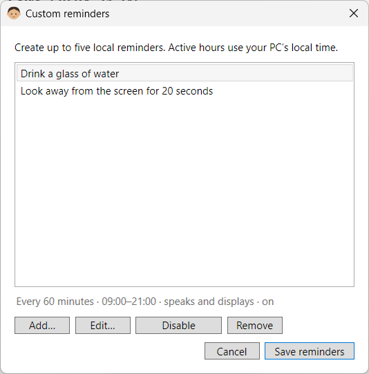

- **Workout reminder** offers a fixed activity interval; when the
  stretch-break pose starts, CloClo says "Time for a short stretch break" (in
  Arabic with Hoda when Arabic voice commands are on).
- **Custom reminders…** lets you keep up to five messages, each with a
  choice of 15, 30, 45, 60, 90 or 120 minutes, active hours, an on/off switch
  and optional speech or a chosen local MP3/WAV sound. Audio plays before
  speech when both are enabled. They use your PC's local time and show while
  the avatar is awake; the reminder outfit returns to normal after the
  message.
- The optional startup greeting speaks the local account name and briefly
  salutes; turn it off under **Privacy**.

### Prayer times and azan

| Prayer times window | Prayer look: Keeper | Prayer look: Lady Keeper |
|---|---|---|
| 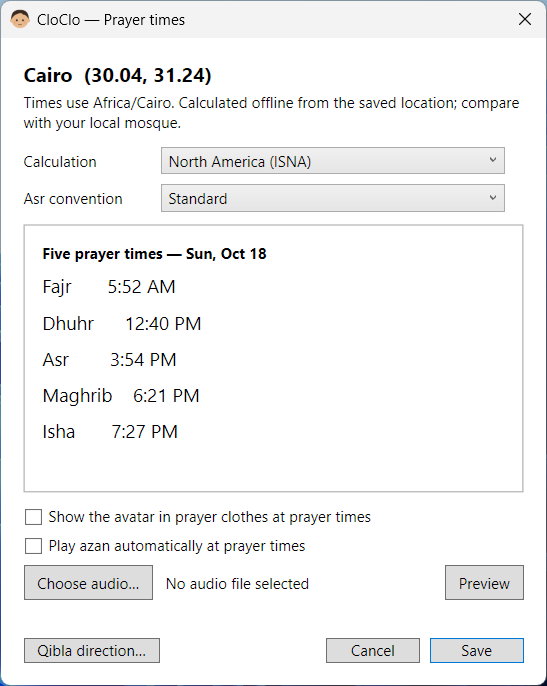 | 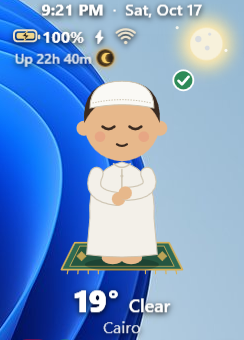 | 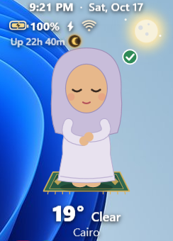 |

Open **Prayer times and azan…** from the menu or search. CloClo calculates
Fajr, Dhuhr, Asr, Maghrib and Isha locally from your saved location. ISNA is
the default; Muslim World League and Egyptian methods, plus Standard or Hanafi
Asr, are selectable. Times are displayed in the saved location's time zone
when available. Changing **Set location…** recalculates the schedule for that
city. Compare calculated times with your local mosque.

- **Qibla direction:** **Qibla direction…** at the bottom of the window shows
  the direction of the Kaaba from your saved location on two compasses: the
  shortest route on the globe (the heading most mosques and Qibla apps use)
  and the straight line on a flat map, with a short explanation of why they
  differ. On a PC with a compass sensor the compasses turn with the PC.
  Most laptops and desktops have none, so North stays at the top unless you
  turn on either of these options, which CloClo remembers:
  - **Turn the compasses to match the way my screen faces:** sit facing the
    screen, hold your phone flat pointing the same way, and set the degrees
    its compass shows with the slider (arrow keys move it by 1°, Page Up and
    Page Down by 15°). The top of each compass is then the way you face, and
    CloClo says how far to turn left or right. Set it again if you move the
    PC.
  - **Show the sun as a guide:** a small sun on both compasses shows where
    the sun is now, worked out from your location and the time, with "face
    the sun, then turn N degrees to your left or right". It updates every
    minute, is hidden after sunset, and says so when the sun is too close to
    overhead to be useful.

  **Read aloud** speaks the directions, in Arabic when Arabic voice commands
  are on, and screen readers read each compass as its direction.

  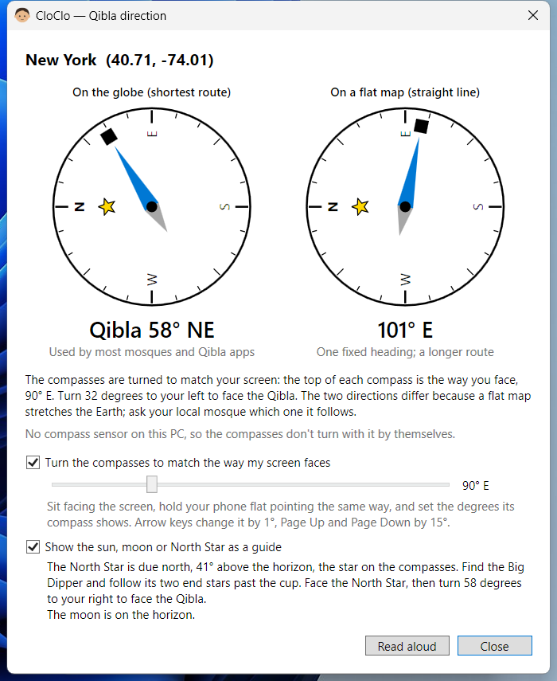
- **Azan:** automatic azan is off until you choose a local MP3 or WAV
  recording and enable it. CloClo plays the recording at the five prayer
  times while it is running; it does not replay prayers missed while the PC
  is asleep or CloClo is closed.
- **Prayer look:** **Show the avatar in prayer clothes at prayer times** is a
  separate opt-in that works with or without the azan. At each prayer time
  Keeper changes into a white thobe and kufi, and Lady Keeper into a long
  prayer dress and a hijab that covers her hair. Both stand barefoot on a
  prayer mat with eyes closed and hands folded on the chest, and the "Fajr
  prayer time"-style label shows. The look stays until you mark the prayer
  done: click the green check beside the head, click the head itself, or
  choose **I've prayed** at the top of the right-click menu. Keeper gives a
  small nod and goes back to the everyday look. If you haven't marked it by
  the next prayer time, the look simply carries on. It isn't kept if CloClo
  restarts. It comes before sleep, the stretch break and custom reminders. A
  stretch break in progress ends and counts as done, and custom reminders
  wait until you've marked the prayer. It keeps the calm breathing in full
  and gentle motion, stays completely still in still mode, and doesn't sway
  in the wind. Turning the option off ends a look in progress. It uses the
  same local calculation, location and method as the azan.
- **Audio:** hold to talk doesn't listen while the azan plays. Everything
  CloClo plays (the azan, reminder sounds, spoken reminders and replies,
  read-aloud text and previews) uses one audio session, so Windows shows a
  single CloClo entry and volume in the volume mixer instead of adding a new
  entry each time.

### Quran memorization

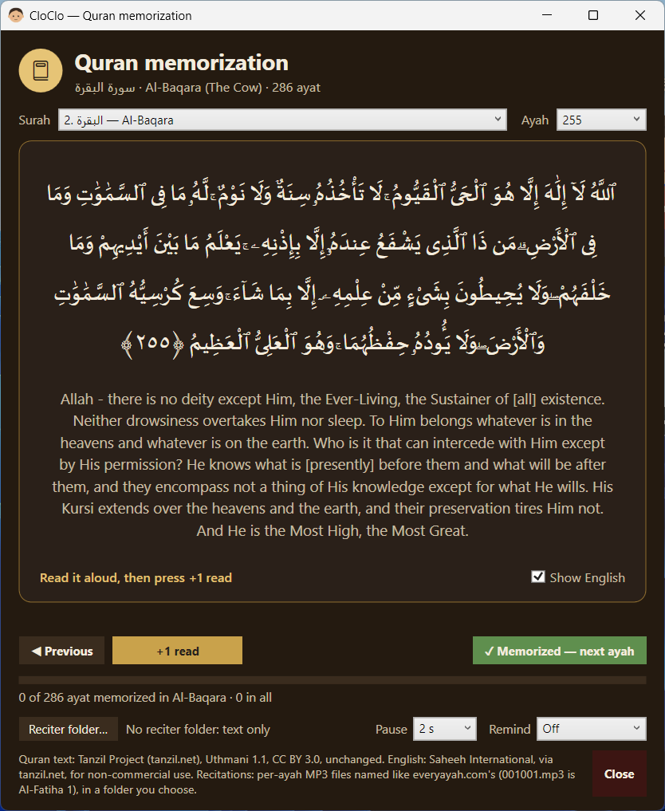

Open **Quran memorization…** from the right-click menu, the search box (try
"quran" or "حفظ") or its 📗 icon on the icon bar. It works one ayah, or a
short run of ayat, at a time and is completely offline:

1. Pick a surah at the top, then the ayat: **Ayah** is where to start and
   **to** where to stop (up to 20 ayat; the same number for one ayah). It
   remembers where you are.
2. The ayat are shown large in Uthmani script, each with its number in
   ornate brackets. On the first ayah of a surah the basmala is shown above
   it and isn't part of what you memorize (Al-Fatiha and At-Tawba excepted).
3. Press **▶ Repeat** to hear them on a loop. With a run, such as ayat 1 to
   5, they're recited one after another with the ayah being recited lit up
   in gold ("Ayah 3 of 1–5"); after the last one comes a short pause (1, 2, 3
   or 5 seconds) and it starts again from the first. The counter shows how
   many times you've heard the whole run; **❚❚ Pause** stops it.
4. When you know them, press **✓ Memorized — next ayah** (or **next 5
   ayat** for a run of five). They're all marked memorized and the next run
   of the same length starts straight away, still looping, so 1–5 is
   followed by 6–10; at the end of a surah the next surah begins.
   **◀ Previous** goes back one run without unmarking anything.
5. Tick **Show English** to see the meaning under the Arabic, in Saheeh
   International's translation, one line per ayah for a run (the Arabic is
   set a little smaller so both fit). It's off by default, so the Arabic stays the focus, and remembered
   once you turn it on.

The progress bar shows how many ayat of the surah you've memorized, and the
total so far.

- **Recitation audio:** choose **Reciter folder…**, a folder on this PC of
  per-ayah recordings named like [everyayah.com](https://everyayah.com)'s
  (`001001.mp3` is Al-Fatiha 1, `002255.mp3` Al-Baqara 255; `.wav` works
  too). CloClo never downloads audio: you choose the reciter and copy the
  files yourself. Without a folder, or for an ayah missing from it, the
  window is text only and **+1 read** counts your own readings instead.

  *Getting Mishary Alafasy's recitation:* everyayah.com publishes each ayah
  as its own file at `https://everyayah.com/data/Alafasy_64kbps/SSSAAA.mp3`
  (surah and ayah, three digits each). Save the ones you need into one
  folder, for example `Assets\Recitations\Alafasy_64kbps\` in the project
  (git ignores `Assets/Recitations/`), then choose that folder under
  **Reciter folder…**. Al-Fatiha and Al-Baqara are 293 files, about 57 MB.
  In Git Bash, this fetches them, pausing briefly between files:

  ```bash
  mkdir -p Assets/Recitations/Alafasy_64kbps && cd Assets/Recitations/Alafasy_64kbps
  for s in 1:7 2:286; do for a in $(seq 1 ${s#*:}); do f=$(printf "%03d%03d.mp3" ${s%:*} $a); [ -s $f ] || curl -sf -o $f "https://everyayah.com/data/Alafasy_64kbps/$f"; sleep 0.2; done; done
  ```

  The recordings are the reciter's work, and everyayah.com states no licence
  for them, so they are for your own use and aren't included in this
  repository. Other reciters are in folders beside `Alafasy_64kbps` on the
  same site.

  *Signed recitation pack:* every install packs the `.mp3` files in each
  `Assets\Recitations\<reciter>\` folder into one file,
  `Recitations\CloClo.Recitations.<reciter>.dll` beside CloClo. It's a .NET
  assembly with no code, only the recitations, signed with the same
  certificate as CloClo itself. CloClo never loads it as code. It holds the
  file open read-only, checks that the signature is intact and that its
  signer is CloClo's own (an unsigned build accepts only an unsigned pack),
  then reads each recitation out of it and plays it from memory, so no MP3
  is written to disk. With no reciter folder chosen, the window uses the
  pack by itself ("Installed: Alafasy_64kbps (signed pack)"). If you chose a
  folder before, **Use installed** switches back to the pack. A pack that
  fails its check isn't used, and the window says so.
- **Avatar reminder:** under **Remind**, choose every 30 minutes, 1 hour or 2
  hours to have Keeper show the ayah you're learning now and then. It shows
  only while the avatar is awake, like the custom reminders.
- **With other sounds:** hold to talk doesn't listen while the recitation
  plays, and the azan or a reminder sound stops the loop.
- **The text** is the [Tanzil Project](https://tanzil.net)'s verified
  Uthmani text (version 1.1) with its surah names, licensed CC BY 3.0 and
  included unchanged with its copyright notice. It's compiled into the
  signed exe, so it can't be altered on disk and nothing is fetched.
  Compare with a printed mushaf if in doubt.
- **The English** is Saheeh International's translation as published by
  Tanzil, also included unchanged and compiled into the exe. Tanzil offers
  it for non-commercial use with attribution, which suits CloClo as a free
  app; anyone redistributing CloClo commercially would need Saheeh
  International's permission.

### Icon bar

The row under the temperature holds up to 7 of these at a time, picked in
right-click → **Icons** (or search for **icon** plus the tool name, for
example **icon stopwatch**):

| Icon | What it does |
|---|---|
| YouTube / Spotify | Shows what's playing there, and keeps it updated |
| Notifications | Shows your latest notification; the list button opens Windows' notification panel |
| Search other apps | Lists current media sessions; selecting one watches its metadata without activating its app |
| Windows status | Opens the [Windows status](#windows-status) window: uptime, sleep, shutdown and sign-in times, CPU, memory, storage, network, power, displays, graphics and security |
| Read selection aloud | Opens the shared speech editor, adds highlighted text, and reads it from the editor (up to 5,000 characters per reading) |
| Selection details | Shows word, character and line counts and a short preview of highlighted text; nothing is saved (the fallback briefly copies selected text) |
| Dictate | Opens the shared speech editor. **Dictate** uses the default microphone and bundled local Whisper model; **Read aloud** speaks the editor's text; **Transcribe playing audio** captures the web browser playing sound (or, with **Browser audio only** turned off, everything on the default speaker output) with the same local model. Load a text file (up to 256 KiB), explicitly save text to the private dictation file, or open that folder from the window. Capture continues until its toggle is turned off or the window closes |
| Convert units | Converts a highlighted "5 km", "98 F"… (km/mi/m/ft, kg/lb, °C/°F/K) |
| Color picker | Pick any color on screen; its hex code is copied (Esc cancels) |
| QR code from selection | Makes a QR code of the highlighted text or link |
| Volume/mute toggle | Mutes or unmutes the system sound |
| Clipboard history | Lists Windows' clipboard history (Win+V); click one to copy it again |
| Stopwatch | One click starts it, the next pauses it, the next stops and resets it; the time shows top-left, under the battery |
| Daily quote, word, joke & fact | A speech bubble with today's quote, an English → Arabic word (with an example), a joke and a "did you know" fact; click it for the next one, × or Esc to close. All built in - nothing is fetched |
| Layer Sudoku (daily game) | Opens the Layer Sudoku game - today's daily puzzle (the same one the HTML version gives, with a streak), or 6×6 to 16×16 at four levels; layer view, method-following hints, notes, undo, timer and pause. Progress is saved |
| Quran memorization | Opens the [Quran memorization](#quran-memorization) window at the ayah you're learning |

| Daily bubble | Stopwatch |
|---|---|
|  | 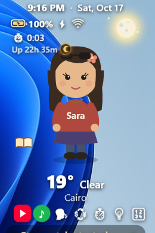 |

| Speech editor (Dictate / Read aloud) | Selection details |
|---|---|
| 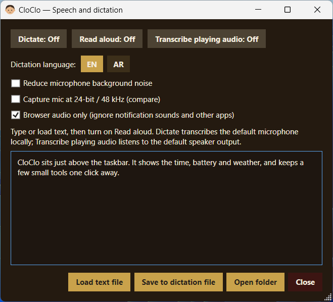 | 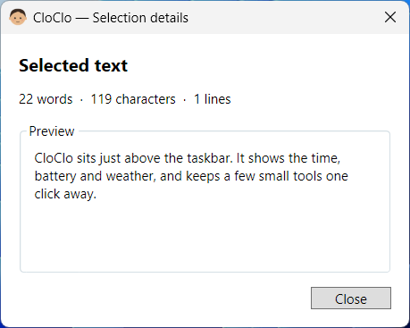 |

| Convert units | QR code from selection | Layer Sudoku |
|---|---|---|
| 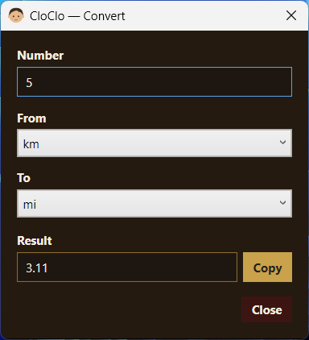 | 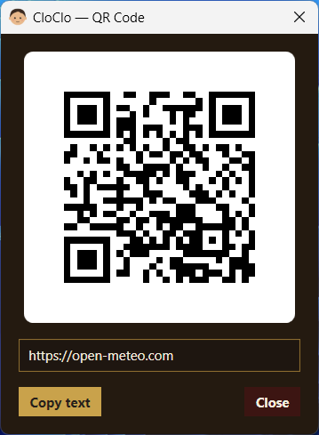 | 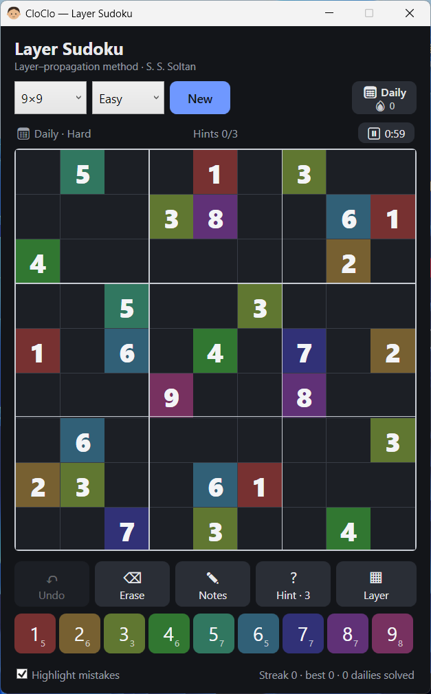 |

The label under the icons only displays metadata; its pause button stops
monitoring. The app picker also only selects a media session to watch and
never activates the source app. Notification watching also gives the avatar a
brief camera, newspaper, maintenance, ChatGPT or Claude pose when the sender
and title match those categories and motion is enabled. It does not read
notifications until you choose **Notifications** from the icon bar or search.

### Search box

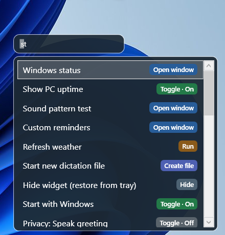

The search box below the widget finds right-click menu actions, including
**Windows status**, **File summary and search**, **Scientific calculator**,
**Custom reminders**, **Prayer times and azan**, **Open dictation folder**,
and avatar, weather and privacy settings.

- Actions that live in a submenu start with its name, as in the menu:
  **Privacy: Show internet connection**, **Weather: Refresh weather**,
  **Dictation: Open dictation folder**, **Voice converters: Letter
  signals**. Typing just the action ("internet") or just the submenu
  ("privacy") finds it.
- Suggestions open below or beside the box; choose with the mouse or arrow
  keys and Enter. Esc closes them.
- Coloured badges distinguish windows, menus, watchers, file actions and
  settings; toggles show their current state.
- Icon-bar actions such as **Read selection aloud**, **Convert units**,
  **Clipboard history** and **Layer Sudoku** remain searchable when their
  icons are hidden.
- A plain **stopwatch** search runs the stopwatch; its badge shows the next
  action: green **Start**, amber **Pause** or red **Stop**.

<br clear="right">

### Right-click menu

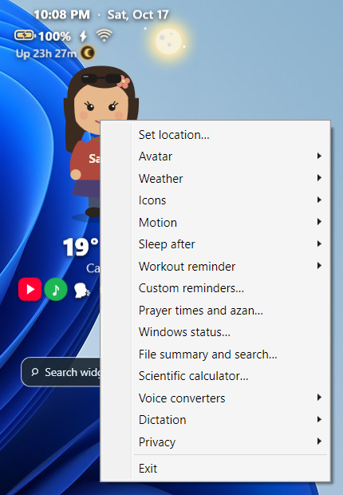

**Right-click** (or double-click) for the menu: **Set location…**,
**Avatar**, **Weather**, **Icons**, **Motion**, **Sleep after**, **Workout
reminder**, **Custom reminders…**, **Prayer times and azan…**, **Quran
memorization…**, **Windows
status…** (a dashboard of the PC's current state), **File summary and
search…**, **Scientific calculator…**, **Online trending sources**, **Voice
converters**, **Dictation**, **Privacy** and **Exit**. The submenus hold:

- **Weather:** the sky to show (live or one you pick) and **Refresh weather**.
- **Online trending sources:** **Google Trends…**, **Wikipedia
  most-read…** and **arXiv newest papers…**, each greyed out until it's
  allowed under Privacy (see
  [Online trending sources](#online-trending-sources)).
- **Voice converters:** Sound pattern test, Voice signals, Find it in David's
  words, Voice converter and Letter signals.
- **Dictation:** **Start new dictation file** and **Open dictation folder**.
- **Privacy:** Hide from screen sharing, Show notification text, Speak
  greeting, Hold right-click to talk and Voice commands in Arabic, then the
  display and startup settings: **Show PC uptime**, **Show internet
  connection**, **Show Bluetooth and headphones**, **Always on top** and
  **Start with Windows**, and last the three online opt-ins: **Allow Google
  Trends (online)**, **Allow Wikipedia most-read (online)** and **Allow
  arXiv newest papers (online)**.

With **Hold right-click to talk** on, holding the button for a second talks
to CloClo instead of opening the menu.

<br clear="right">

### Windows status

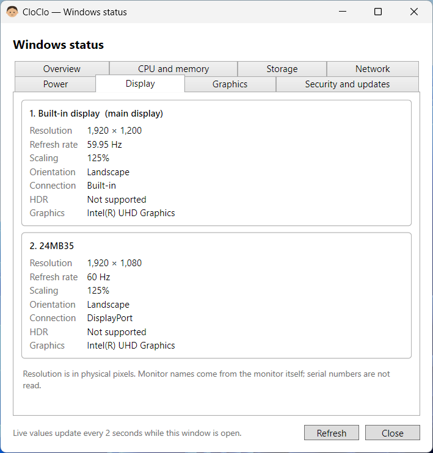

**Windows status** (menu, search or its icon) is a dashboard of the PC's
current state in tabs. Everything is read locally without administrator
rights; nothing is sent, tested online or changed.

- **Overview:** processor and memory use, system drive space, power and
  connection at a glance; Windows edition, version and build, system type,
  PC name, uptime, last start (after a shut down, a restart or an
  unexpected shutdown) and install date. Below them, yesterday and today
  as cards: whether Fast Startup is on (a check box, shown only), then
  Sleep, Hibernate (Fast Startup shutdowns too, since Windows logs them as
  hibernations), Shutdown and restart, Sign-out, Sign-in and Charger
  (plug-in and unplug times; a connection cutting out for seconds at a
  time is grouped into one row with its times), each row showing what
  you did (e.g. signed out, then clicked Shut down on the sign-in screen)
  next to what Windows logged in its own words, and the day totals,
  including time on battery. Each shutdown or restart row has a coloured
  tag for how it was asked for: green **voice** (CloClo by voice), grey
  **manual** (Start, the sign-in screen, the power button…) or red
  **crash** (stopped without shutting down).

Beside the avatar's **Up 3h 12m** sits a small icon: a moon once that time
includes sleep or hibernation, or a power symbol right after a restart or
full shutdown. Hovering it shows the details, starting with the last
shutdown; the same coloured tag follows the icon on the widget.
- **CPU and memory:** usage bars, processor model and cores, process,
  thread and handle counts, memory in use, available, installed, modules
  and speed, committed and cached, and the eight apps using the most
  memory (grouped by process name).
- **Storage:** every fixed drive with a usage bar, free, used, capacity and
  file system. Removable and network drives are skipped so a missing device
  can't stall the window.
- **Network:** Windows' own connectivity and metered status, and for each
  connected adapter its type, hardware, link speed, live activity, local
  IPv4 address, DHCP and whether it has a gateway.
- **Power:** power source, battery charge and time left, battery saver,
  power plan and power mode.
- **Display:** each monitor's name, resolution, refresh rate, scaling,
  orientation, connection (built-in, HDMI, DisplayPort…), HDR and the GPU
  driving it.
- **Graphics:** each GPU's video memory, driver version and date, and how
  many displays it drives.
- **Security and updates:** antivirus, real-time and tamper protection,
  definition and scan dates, Windows Firewall, Secure Boot, memory
  integrity, User Account Control, Smart App Control, the latest installed
  update and whether a restart is pending. It can't tell whether newer
  updates exist, since that would mean contacting Windows Update.

Processor and memory refresh every 2 seconds, and the open tab's live
values with them; drives, network, power and displays every 15 seconds;
the rest when the window opens or on **Refresh**. Timers run only while the
window is open, and each source is read separately in the background, so a
slow one doesn't hold up the others. Left out on purpose: the account name,
MAC addresses, serial numbers, the Wi-Fi network name, IPv6 addresses and
the public IP, and process paths, command lines and window titles.

### File summary and search

| Summary tab | Search tab |
|---|---|
| 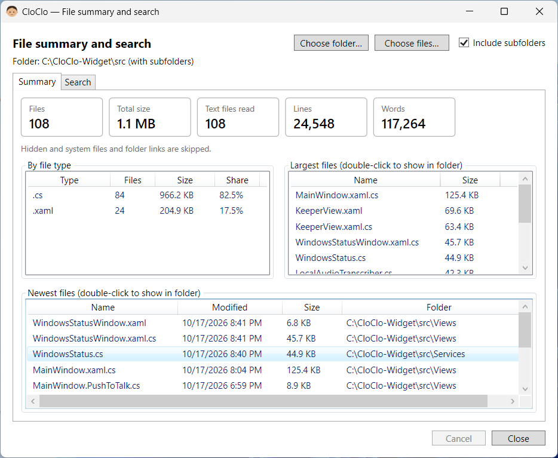 | 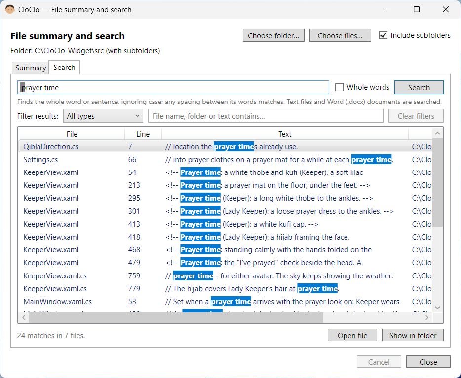 |

Open **File summary and search…** from the right-click menu or the search box
(try "files", "folder" or "find text"). Choose a folder (**Include
subfolders** is on by default; untick it for that folder only) or pick one or
more files.

- **Summary** shows the number of files, total size, a breakdown by file type
  with each type's share of the size, the ten largest and ten newest files,
  and line and word counts for the text files.
- **Search** finds a word or sentence in those files, ignoring case: the
  whole phrase must appear on one line (any spacing between its words
  matches), and **Whole words** stops "cat" matching "category". Each match
  shows the file, line number, the text around it with the phrase
  highlighted, and the folder; results are listed by file and line when the
  search finishes.
- **Filter results** narrows the matches already found, without searching
  again: pick a file type (the list shows each type's match count), and/or
  type text that the file name, folder or matching line must contain. The
  status line then says how many matches are shown, and **Clear filters**
  shows them all again. A chosen type stays chosen for the next search.
- Double-click a match or use **Open file**: text files open in Notepad
  (Ctrl+G goes to the line) and Word documents in your usual app. **Show in
  folder** (or double-clicking a largest/newest file) opens File Explorer
  with the file selected. Listing, counting and searching run in the
  background with a progress bar and **Cancel**.
- *What is read:* plain-text and source-code files by extension (`.txt`,
  `.md`, `.csv`, `.log`, `.json`, `.xml`, `.yaml`, `.ini`, `.html`, `.css`,
  `.js`/`.ts`, `.cs`, `.py`, `.java`, `.c`/`.cpp`, `.go`, `.rs`, `.sql`,
  `.ps1`, `.bat`, `.sh`, `.srt` and similar), in UTF-8 or with a UTF-16 byte
  order mark, plus the body text of Word `.docx` documents, where the line
  number is the paragraph number (shown as ¶). A "text" file that turns out
  to be binary is skipped. PDFs and other formats are counted in the summary
  but not read: reading PDF text needs a third-party parser, which CloClo
  doesn't ship.
- *Limits:* hidden and system files, and folder links (junctions and
  symbolic links), are skipped; listing stops at 200,000 files; text files
  over 32 MB and `.docx` files over 64 MB are listed but not read; a search
  stops after 5,000 matches. Network shares are refused.
- *Privacy:* everything is read locally, nothing is saved or sent, and the
  chosen folder isn't remembered; closing the window cancels the work and
  forgets the list and results. Files are only opened for reading, and
  **Open file** only opens the text and Word types above, so a match can't
  start a program or script: scripts open as text in Notepad. The window
  follows the screen-capture privacy setting, since it shows file names and
  contents.

### Scientific calculator

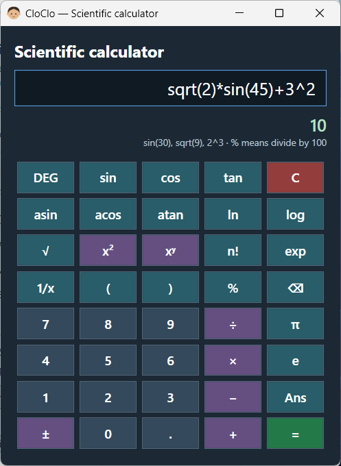

Open it from the search box or right-click menu. It supports typed
expressions, a keypad, degree/radian mode, trigonometry, logarithms, roots,
powers, factorials and `Ans`. The result updates as you type. Calculations use
a bounded local arithmetic parser, not a scripting engine or network service.

<br clear="right">

### Online trending sources

Three optional windows show what people are looking at today and the newest
research papers. Each goes online, so each is a separate opt-in that is
**off by default**: turn on **Allow Google Trends (online)**, **Allow
Wikipedia most-read (online)** or **Allow arXiv newest papers (online)**
under right-click → **Privacy**. Until then its entry under right-click → **Online
trending sources** is greyed out (hover it to see why), and choosing it from
search only says it's off. Turning an opt-in off closes its window.

| Only arXiv allowed: the other two are greyed out | arXiv newest papers in Mathematics |
|---|---|
| 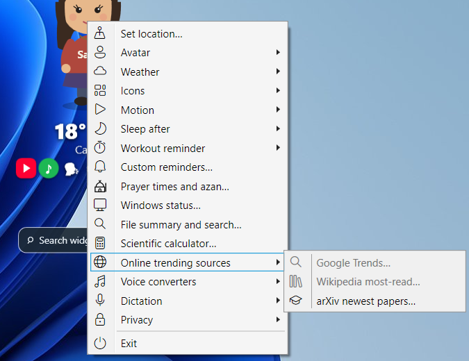 | 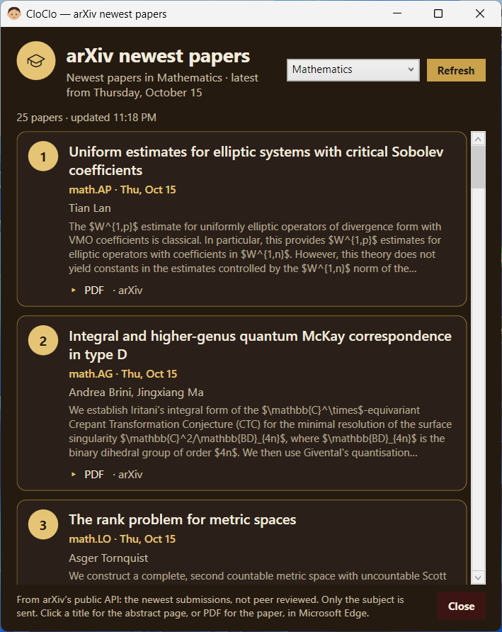 |

- **Google Trends…** lists today's trending searches for a country, ranked,
  with the approximate number of searches and up to three related news
  headlines with their sources. Pick the country at the top (18 are offered;
  the default follows Windows' region setting). Click a topic to search it,
  or a headline to read it.
- **Wikipedia most-read…** lists the 25 most-read articles in English,
  Arabic, French, German, Spanish or Italian Wikipedia, with each one's views,
  how that compares with the day before (▲ up, ▼ down) and a one-line
  description. Wikipedia publishes the list a day or two after the day ends,
  so the window shows the newest list available and says which day it
  covers. Click an article to open it.
- **arXiv newest papers…** lists the 25 newest papers submitted to
  [arXiv](https://arxiv.org) in a subject you pick (Mathematics, the default;
  Computer science, Artificial intelligence, Machine learning, Physics,
  Quantum physics, Astrophysics, Statistics, Quantitative biology,
  Quantitative finance, Economics or Electrical engineering). Each shows its
  sub-field, submission date, authors and the start of its abstract (maths
  appears as the authors wrote it, in LaTeX). Click a title for the abstract
  page, or **PDF** for the paper. arXiv papers are preprints, not peer
  reviewed, and arXiv announces new ones on weekdays, so over a weekend the
  newest can be a day or two old.

The windows fetch only when they open or when you press **Refresh**;
nothing runs in the background. Google is sent only the country code,
Wikipedia only the language and a date, and arXiv only the subject (and
CloClo waits three seconds between arXiv requests, as arXiv asks). Text is
shown as plain text, and
links open in Microsoft Edge from Program Files after its Microsoft
signature is checked, and only if they are `https://` links. Arabic titles
and headlines are laid out right to left.

### Voice signal tools

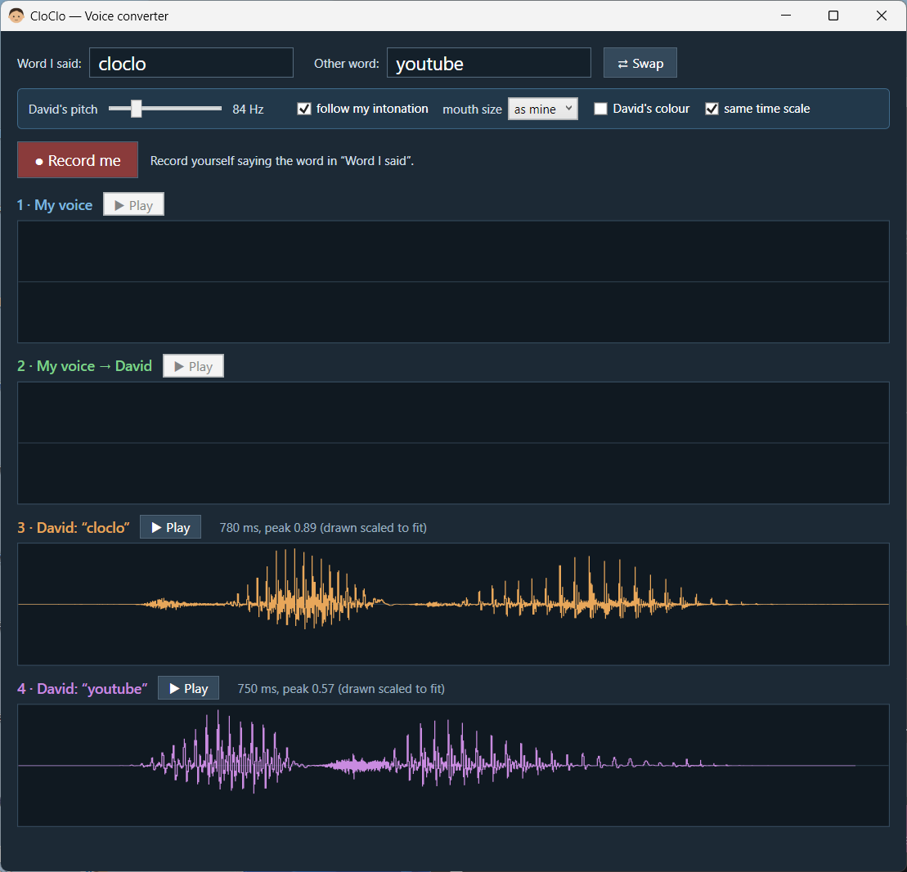

The search box and right-click → **Voice converters** open Sound pattern
test, Voice signals, Find it in David's words, Voice converter, and Letter
signals. These local
experiments compare microphone samples with synthesized Windows voices.
Recordings stay in memory and stop when their windows close. Sound pattern
test can save measured sound pieces to
`%AppData%\CloCloWidget\sound-pieces.json` only when you choose to teach or
save them; the file contains measurements and your letter, word, and speaker
labels, but no recorded audio.

### Hold right-click to talk (open an app by voice)

Turn it on under right-click → **Privacy** → **Hold right-click to talk**.
Then, anywhere on the screen (you don't need to find CloClo), hold the right
mouse button for about a second until CloClo says "Listening.", say an app
name and let go. CloClo says "Opening Word now." and opens it, with no
confirmation:

| 1. Hold right-click for about a second | 2. "Listening." — say the app name | 3. Let go: "Opening Word now." | 4. Word opens |
|---|---|---|---|
| 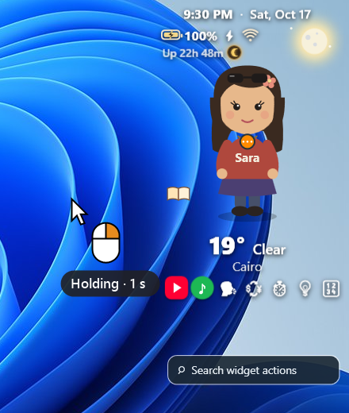 | 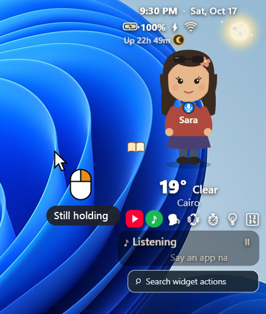 |  | 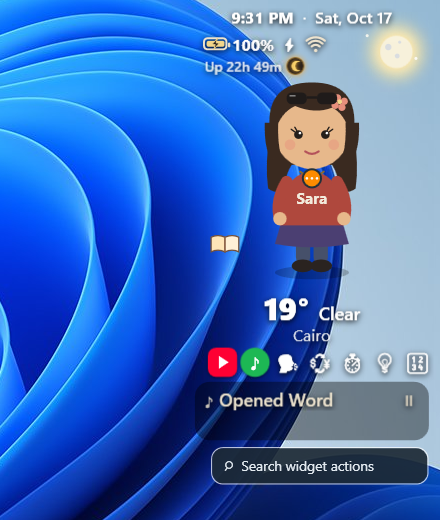 |

The badge on the avatar's chest follows each step: orange dots while the
microphone starts or the command is being worked out, a blue microphone
while CloClo is listening, and an orange "!" if nothing usable was heard.
The mouse in the first two pictures is drawn in, since screenshots leave out
the pointer.

| Say | Opens |
|---|---|
| Notepad | Notepad |
| Paint, Paintbrush | Paint |
| OneDrive | OneDrive |
| Snipping Tool | Snipping Tool |
| Settings | Windows Settings |
| YouTube | YouTube in Microsoft Edge |
| Spotify | Spotify (Microsoft Store version) |
| Word | Microsoft Word |

Close pronunciations work too ("ward" opens Word, "not bad" Notepad). Every
step is spoken, including "I didn't hear a command." and "That is not an
approved command.", so it can be used without seeing the screen. With
**Voice commands in Arabic** on, say the Arabic names (المفكرة، الرسام،
وورد…) and CloClo answers in Arabic. A normal short right-click still opens
the menu of whatever is under the cursor. Details are under
[Security](#security).

**Shut down by voice.** Hold right-click and say "shut down" (or "turn off
the PC", "اقفل الجهاز"). This is always a full shutdown: Windows signs out
and powers off without saving its session for Fast Startup, so the next
start is fresh, as after a restart, but the PC stays off. Your Fast Startup
setting isn't changed, and the Start menu's Shut down keeps working as
before.

1. If apps are open, CloClo names them, for example "2 apps are open:
   Microsoft Word, Microsoft Edge", and waits for your answer. Hold
   right-click and say **close** (or "yes", "اقفلهم") to close them and shut
   down, or **cancel**.
2. CloClo asks each app to close, as its ✕ button does, so an app with
   unsaved work asks you to save as usual. When none is left, CloClo says
   "All apps are closed. Shutting down now."
3. If an app is still open after ten seconds (usually waiting for you to
   save), CloClo names it again. Save and say **close** to try again, say
   **force close** to close it without saving, or say **cancel**.
4. With no apps open, CloClo says it will shut down in ten seconds, and
   **cancel** stops it.

A **Shut down** window opens in the middle of the screen alongside the
voice. It shows the same step, the list of open apps, and buttons that answer
like your voice does: **Close apps and shut down**, **Try again** and
**Force close** when an app stays open, **Shut down now** during the
countdown, and **Cancel** (or Escape, or closing the window). Screen readers
announce each new step.

Saying nothing for a minute, turning hold to talk off or closing CloClo also
cancels. Only these exact phrases shut down; a word that merely sounds close
is not enough.

Windows records each voice shutdown in its System log: in Event Viewer,
**Windows Logs → System**, event **1074** (source User32) names
`CloCloWidget.exe` with the comment **CloClo voice command**. CloClo also
adds a line to `%LOCALAPPDATA%\CloCloWidget\power-requests.log` in case
Windows doesn't log it. Windows status and the uptime tag use these to show
the shutdown as **voice**.

### Privacy and data

- **Privacy:** by default, CloClo requests Windows capture exclusion for the
  widget and several tool windows that show private content, including
  clipboard history, QR codes, selection details, Windows status, file
  summary and search, and the calculator. This helps with supported Windows
  capture paths; it is not a guarantee against every recorder or a camera
  pointed at the screen. Notification text can be switched off so only the
  sending app's name shows.
- **Where things are kept:**
  - Settings: `%AppData%\CloCloWidget\settings.json`
  - Sudoku progress: `%AppData%\CloCloWidget\sudoku.json`
  - Quran memorization progress: `%AppData%\CloCloWidget\quran.json`
  - Dictation: `%LocalAppData%\CloCloWidget\Dictation`
  - Error log: `%LocalAppData%\CloCloWidget\errors.log`

## Installing

`scripts/install.ps1` builds, signs (optional) and installs CloClo with a Start Menu
shortcut; run it again any time to upgrade. `scripts/Install-CloClo.cmd` is simply
`scripts/install.ps1 -ProgramFiles -UseCloCloCertificate -DesktopShortcut`. All the
options:

```powershell
.\scripts\install.ps1                                   # per-user install, unsigned
.\scripts\install.ps1 -ProgramFiles                     # install to Program Files instead (recommended)
.\scripts\install.ps1 -CertThumbprint <thumbprint>      # sign with a certificate from your store
.\scripts\install.ps1 -UseCloCloCertificate             # sign with your newest protected CloClo certificate (offers to create one)
.\scripts\install.ps1 -DesktopShortcut                  # also put a shortcut on the desktop
.\scripts\install.ps1 -NoLaunch                         # don't start CloClo afterwards
.\scripts\install.ps1 -Uninstall                        # removes either kind of install
```

The options combine. If Windows says running scripts is disabled, start it as
`powershell -NoProfile -ExecutionPolicy Bypass -File .\scripts\install.ps1` (plus any options) —
that allows this one run without changing any system setting. Keep
`-NoProfile` in it: your PowerShell profile is a script any program running
as you can edit, and without it that script would run first, inside the
installer.

Run it from a regular PowerShell window: it refuses an administrator window
(building should never run as admin; it asks for administrator rights itself
when it needs them — unless User Account Control is switched off, when every
window is an administrator one), and PowerShell ISE can't pass your typing to it, so it
stops with a message there rather than waiting for an answer it can't get.

Every install closes a running CloClo first, so the exe can be replaced, and
enables "Start with Windows" for the current user on a first install. Upgrades
keep the user's on/off choice and move an enabled entry to the installed copy.
At sign-in, CloClo waits for Defender, Windows Security, and Security Center
services to report running before showing the widget. If those services are
unavailable, it starts after at most 90 seconds; opening CloClo manually is
immediate. CloClo does not change security settings or require administrator
rights to run.

CloClo then appears in **Settings → Apps → Installed apps** (an entry in your
own account's registry, for both kinds of install), and can be uninstalled
from there. That runs the `uninstall.ps1` installed next to the
exe, which removes the program, its shortcuts and its "Start with Windows"
entry and its Windows Startup apps record (asking for administrator rights for
a Program Files copy) but leaves
your settings and dictation files in AppData. `.\scripts\install.ps1 -Uninstall`
from the project folder does the same.

### Per-user or Program Files

| | Per-user (default) | Program Files (`-ProgramFiles`) |
|---|---|---|
| Location | `%LocalAppData%\Programs\CloCloWidget` | `C:\Program Files\CloClo` |
| Administrator prompt | none | one, for the copy only |
| Who can change the installed files | any program running as you | administrators only |
| WPF's native DLLs | inside the exe, unpacked to `%TEMP%` at runtime and checked at startup | next to the exe, in Program Files |

With `-ProgramFiles`, building, signing and the registry entries all happen
as you (your certificate is in your own store); only the copy into Program
Files is elevated. That step is `place.ps1`, a fixed script that receives
only data — the `publish\` folder, the SHA-256 of every built file, and a
certificate change you confirmed with `YES`. What the administrator prompt
starts is a short bootstrap, and that's all its **Show more details** shows:
`place.ps1`'s full path and SHA-256 (compare it with
`Get-FileHash .\scripts\place.ps1` if you like), the `publish\` folder and every file
with its SHA-256. As administrator, the bootstrap reads `place.ps1` once,
checks it against that SHA-256 and runs exactly those bytes from memory, so a
`place.ps1` swapped after the installer checked it never runs. Running as
administrator, `place.ps1` trusts nothing it's handed:

- it works out `C:\Program Files\CloClo` itself, so nothing passed in decides
  what is created or removed;
- it refuses files with unexpected names and files that are links;
- it copies everything into a staging folder (`CloClo.new`) inside Program
  Files, where only administrators can change it, and checks there that it
  holds exactly the expected files, each with exactly its built SHA-256, the
  exe signed by the same certificate as the installed copy (or the one you
  accepted), and every DLL intact and signed by Microsoft;
- Quran recitation packs (`Recitations\CloClo.Recitations.<reciter>.dll`,
  built by `scripts\pack-recitations.ps1` from the project's
  `Assets\Recitations\<reciter>\SSSAAA.mp3` files) are checked like every
  other file: by name, by SHA-256, and as signed by the exe's own
  certificate. `Recitations\` is the only folder allowed besides `gpu\`, and
  CloClo's startup check accepts nothing in it but pack files;
- only then does it swap the folders. A swap fails as a whole while the old
  copy is in use, and on any failure the previous copy is put back — CloClo
  is never left half-installed.

If it refuses, the installer says why ("Not installed: …"). Afterwards it
checks, as you, that Program Files holds exactly the files that were built,
and removes the per-user copy, if any. CloClo itself always starts as your
normal user.

To switch back to a per-user install, run `.\scripts\install.ps1 -Uninstall` first
(it asks for administrator rights to remove the Program Files copy), then
install without `-ProgramFiles`. If the Program Files copy was installed by
`CloClo-Setup.exe`, uninstall it from Settings > Apps first.

### Signing

With a certificate, `sign.ps1` runs inside the build in two stages, since the
single-file exe carries every DLL inside it:

1. Just before bundling, every DLL that has no signature at all — the app's
   own `CloCloWidget.dll` and unsigned third-party ones such as `QRCoder.dll`
   — is copied to `obj\...\signed\`, the copy is signed, and the bundle is
   built from the signed copies. Microsoft's runtime DLLs keep their own
   signatures, and nothing in the NuGet cache is modified. A DLL whose
   signature no longer verifies (changed after its publisher signed it)
   stops the build instead of being signed over.
2. The finished `CloCloWidget.exe` is signed.

Everything is SHA-256 signed with an RFC 3161 timestamp (so signatures stay
valid after the certificate expires) and checked right after signing; any
failure fails the build.

Which certificates can sign:

- **From your certificate store** (`-CertThumbprint`): only one whose private
  key Windows protects — strong key protection, where Windows asks you to
  confirm (or enter a password) every time something signs with it, or a
  smart card. An unprotected key is refused, since any program running as you
  could sign its own files as CloClo with it.

File-based `.pfx` signing is not supported. It temporarily imported an
unprotected key into the user's certificate store, allowing another process
running as that user to sign during the build. Use a protected store key.

An Authenticode code-signing certificate can also come from a trusted signing
provider; check that provider's current availability and terms before choosing
one.

**Updates keep the certificate.** The installer only replaces an installed
CloClo with a build signed by the same certificate. If it differs — or the
new build is unsigned and the installed one isn't — it shows both thumbprints
and continues only if you type `YES`. A swapped build signed by someone else
would look exactly like that, so only answer yes when you changed the
certificate yourself.

#### Signing with your own certificate (left untrusted)

A self-signed certificate signs everything exactly like a bought one; the only
difference is that no Windows PC trusts it, so the publisher still shows as
unverified. It stays that way on purpose — it's never added to Windows'
trusted roots.

**The easy way:** double-click `scripts/Install-CloClo.cmd`. It uses your newest
certificate named `CN=CloClo…` (for example `CN=CloClo` or
`CN=CloClo_yourname`) whose key is protected, and if there's none it asks
whether to create one — nothing else to type.

**By hand** — the commands below use the name `CN=CloClo`. If yours has
another name, use that name in every command, otherwise loading or deleting
the certificate finds nothing.

**First time — create the certificate** (once; it's valid for five years).
`-KeyProtection Protect` gives it a protected private key; Windows shows a
dialog while creating it, where you pick how each signing is confirmed —
Medium asks you to click OK, High asks for a password:

```powershell
$cert = New-SelfSignedCertificate -Type CodeSigningCert -Subject "CN=CloClo" -CertStoreLocation Cert:\CurrentUser\My -KeyProtection Protect -NotAfter (Get-Date).AddYears(5)
```

**Every time — sign and install.** In a new PowerShell window, load the
certificate first (this picks the newest one, so it works even if there's
more than one); in the window you just created it in, `$cert` is already set:

```powershell
$cert = Get-ChildItem Cert:\CurrentUser\My -CodeSigningCert | Where-Object Subject -eq "CN=CloClo" | Sort-Object NotBefore -Descending | Select-Object -First 1
```

Then build, sign and install:

```powershell
powershell -NoProfile -ExecutionPolicy Bypass -File .\scripts\install.ps1 -ProgramFiles -CertThumbprint $cert.Thumbprint -DesktopShortcut
```

Windows may ask you to approve signing while it handles the DLLs and finished
exe. The build prints "signed, but the certificate isn't trusted on this
machine" for each file, and the last line reads "signed, but this PC doesn't
trust the certificate yet". Both are expected.

**Replacing the certificate** — for example one made before key protection
was required, which the build now refuses. Delete every CloClo certificate
together with its private key (other certificates aren't touched), then
either double-click `scripts/Install-CloClo.cmd` (it offers to create the new one) or
create it and install by hand as below. Either way the installer asks for
`YES` once, because the certificate changed:

```powershell
Get-ChildItem Cert:\CurrentUser\My | Where-Object Subject -eq "CN=CloClo" | ForEach-Object { Remove-Item -Path "Cert:\CurrentUser\My\$($_.Thumbprint)" -DeleteKey }
```

```powershell
$cert = New-SelfSignedCertificate -Type CodeSigningCert -Subject "CN=CloClo" -CertStoreLocation Cert:\CurrentUser\My -KeyProtection Protect -NotAfter (Get-Date).AddYears(5)
```

```powershell
powershell -NoProfile -ExecutionPolicy Bypass -File .\scripts\install.ps1 -ProgramFiles -CertThumbprint $cert.Thumbprint -DesktopShortcut
```

Deleting the key is permanent, and already-signed copies keep their
signature. Keep the private key to yourself — never export the certificate
with its key.

### An installer for other PCs (CloClo-Setup.exe)

Double-click **`scripts/Build-Setup.cmd`**. It builds CloClo, wraps it in a Windows
Installer package and a setup program, signs all three with your CN=CloClo
certificate (Windows asks you to confirm each signing), and leaves
`dist\CloClo-Setup-<version>.exe` (compressed; size varies by build) and a
matching `CloClo-Setup-<version>.txt` build log containing that exact EXE's
SHA-256. Signing approvals happen in Windows dialogs and are not logged.

That one file installs CloClo on any 64-bit Windows 10/11 PC — no .NET SDK
or source folder needed there:

- Windows' own installer does the work: the administrator prompt names the
  publisher, a failed install rolls back completely, and Settings > Apps gets
  an entry with Uninstall.
- It installs to Program Files\CloClo with Start Menu and public desktop
  shortcuts, enables "Start with Windows" for the installing user, closes a
  running CloClo first, and a newer setup replaces an older install in place.
  The sign-in launch waits for the Windows security services as described
  above. The widget's menu can turn startup off again.
- The last page has a **Launch** button, which starts CloClo as you, not as
  administrator.
- To uninstall: Settings > Apps > CloClo > Uninstall, or run the setup again
  on a PC that has it - it opens on an Uninstall page. Settings, Sudoku
  progress and dictation files are kept. MSI removes the startup entry it
  installed; Windows may retain its separate Startup apps approval record.
- To install without any screens: `CloClo-Setup-<version>.exe /quiet`
  (and `/uninstall /quiet` to remove it).

Send the SHA-256 with the file, so the person installing it can check
(`Get-FileHash`) that they got exactly what you built.

On other PCs your self-signed certificate isn't trusted, so Windows shows the
publisher as unknown and SmartScreen warns before it runs. For a clean
install elsewhere, sign with a publicly trusted code-signing certificate
and pass it:
`.\scripts\Build-Setup.cmd -CertThumbprint <thumbprint>`.

If a script-based CloClo installation is registered for your account or PC, uninstall
it from Settings > Apps > Installed apps before running the setup. The setup
shows this instruction and disables Install until you close and reopen it after
removing the old installation. Direct MSI and silent installs also refuse to
install while the script registration remains. A newer MSI setup replaces an
older MSI setup through Windows Installer. The script installer also refuses
to copy over an MSI-managed installation until it is uninstalled.
Uninstalling leaves your settings (%AppData%\CloCloWidget) and dictation files.

## Checking the source

Every install records the SHA-256 of each source file in the project folder
(everything except build output: `bin`, `obj`, `publish`, `.vs`), plus the
git commit, in `source-manifest.json` — taken just before the build and
checked again right after it, so the record matches what was actually built.
The record and its checker, `check-source.ps1`, are installed next to the
program; in Program Files only administrators can change them, so whatever
might change the code can't also rewrite the record.

Double-click **`scripts/Check-Source.cmd`** to compare the project folder with the
last install. It runs the *installed* checker and lists every file that was
changed, added or removed since then — or says that all of them still match.
Right after an install it reports no changes; any change you then make
yourself (editing code, `git pull`) shows up until the next install records
the new state.

The installer runs the same check automatically before every build: if the
source changed since the last install, it lists the changed files and only
builds after you type `YES` — so code nobody meant to change can't be built
and signed with your key unnoticed. Run it before building again if you're unsure whether
something touched the code. (With a per-user install the record sits in a
folder you can write to, so the check is weaker; the script says so.)

## Troubleshooting

| What you see | What to do |
|---|---|
| "running scripts is disabled on this system" | Start it as `powershell -NoProfile -ExecutionPolicy Bypass -File .\scripts\install.ps1 …` |
| "Run this from a normal PowerShell window" | You're in an administrator window — open a regular one |
| It stops with "Can't ask for YES here" | You're in PowerShell ISE — use Windows PowerShell or Windows Terminal |
| "has an unprotected software key" | Replace the certificate (see [Replacing the certificate](#signing-with-your-own-certificate-left-untrusted)) |
| "This build isn't signed by the same certificate" | Expected once after you change certificates — type `YES`; otherwise stop and find out why |
| "Not installed: …" after the administrator prompt | The reason is in the message (a broken signature, another certificate, a non-Microsoft DLL, a changed or unexpected file, or the copy in use). Nothing was changed; fix that and run the install again |
| "Couldn't close the running CloClo" | A copy was started as administrator — right-click it → Exit, then run the installer again |
| "The .NET SDK wasn't found" | Install the .NET 10 SDK from dotnet.microsoft.com (it installs under Program Files) |
| CloClo says it "won't start while these files are next to it" or "found native files it can't verify" | Something placed files beside or into CloClo — delete the files it names, consider a malware scan, and reinstall |
| CloClo "won't run with a .NET profiler attached" | Remove the listed environment variables (System Properties → Environment Variables), sign out and back in |
| CloClo doesn't start at sign-in | Check **Settings → Apps → Startup** has CloClo switched on; otherwise right-click it → **Privacy** → **Start with Windows** off and on again |
| "Source files … changed while building" | Something edited the project during the build — run the install again, and use `scripts/Check-Source.cmd` if you didn't expect changes |
| `scripts/Check-Source.cmd`: "isn't installed with a source record yet" | The installed copy predates source records — run `scripts/Install-CloClo.cmd` once |
| `scripts/Check-Source.cmd` lists changes you didn't make | Don't build or install; look at the listed files first (`git diff` shows what changed) |
| The installer lists source changes and asks for `YES` | Expected after you edited code or pulled; if you didn't, answer anything else and check the files |
| Restore fails with NU3004 / NU3018 | A package isn't signed by nuget.org (or nuget.org renewed its certificate) — if it's genuinely from nuget.org, re-run `dotnet nuget trust source nuget.org` with the configfile option pointing at `nuget.config` |

## Rebuilding from source

```bash
dotnet build
dotnet run
```

A plain `dotnet build` is fine for development but isn't the installed
layout: it unpacks nothing, so the startup checks of native files have
nothing to do, and it never touches "Start with Windows". `install.ps1` is
the way to get a real installed copy.

To produce a standalone .exe by hand:

```bash
dotnet publish -c Release -r win-x64 --self-contained true -p:PublishSingleFile=true -p:IncludeNativeLibrariesForSelfExtract=true -o ./publish
```

To sign it the same way `install.ps1` does, add
`-p:SignCertThumbprint=<thumbprint>` for a protected store certificate.

## How it's built

A WPF host window (transparent, borderless, topmost by default, no taskbar
entry, click-through) hosts `KeeperView` — a native WPF drawing of the app's
Keeper or Lady Keeper avatar with weather, sleep, workout, prayer and custom-reminder
outfits, time-of-day details, notification poses and adjustable motion. There
is no embedded browser. `WeatherService` fetches the current temperature and
WMO weather code from Open-Meteo on the host and maps it to a sky
(clear/cloudy/rain/snow/storm…).
A second, invisible window sized to the avatar takes the clicks — dragging,
the icon bar, search box and the right-click menu. The calculator evaluates a
fixed arithmetic grammar in memory; text entered there cannot run commands.

`Program.Main` runs `NativeLibraryCheck` before WPF loads anything (see
Security below). The build itself, through targets in `CloCloWidget.csproj`,
records the SHA-256 of every native runtime DLL it ships
(`NativeLibraryPins.g.cs`) and, with a certificate, calls `scripts/sign.ps1`;
`scripts/install.ps1` drives the whole build-sign-install sequence, and
`scripts/check-source.ps1` records and checks the source fingerprint. The
`.cmd` files in `scripts/` are double-click launchers for those scripts.

## Security

**What CloClo shows and sends**

- **No browser engine.** Keeper is drawn natively in WPF, so there's no web
  page, script or embedded Chromium to attack. The only network calls are
  HTTPS requests to Open-Meteo (weather, place search) and OpenStreetMap
  Nominatim ("Use my location"), plus, only after you allow each one under
  Privacy, Google Trends (`trends.google.com`, sent the country code),
  Wikipedia (`<language>.wikipedia.org`, sent the language and a date) and
  arXiv (`export.arxiv.org`, sent the subject). All
  use fixed hosts, no cookies or redirects, a 15-second timeout and a 1 MB
  response limit.
- **Trending lists are text, links are checked.** The Google and arXiv
  feeds are parsed as XML with DTDs refused; titles and headlines are shown as plain text with
  control characters removed and lengths capped. A link opens only if it's an
  absolute `https://` URL without a user name or password, and only in
  Microsoft Edge from Program Files after its Microsoft signature is checked
  (never through the shell or a protocol handler).
- **Location stays coarse.** Coordinates are rounded to about 1 km before
  they're saved or sent anywhere; a precise GPS fix never leaves the machine.
- **Capture exclusion request.** By default, CloClo asks Windows to exclude
  the widget and selected tool windows from supported capture APIs
  (right-click → Privacy). [Windows documents this as a capture aid](https://learn.microsoft.com/en-us/windows/win32/api/winuser/nf-winuser-setwindowdisplayaffinity),
  not a security boundary or a guarantee against every way to record a screen.
  Notification text can be switched off so only the sending app's name shows.
- **File summary and search reads, never runs.** Only files on local drives
  are listed, folder links aren't followed, and only the text and `.docx`
  types it knows are opened, read-only. A `.docx` is read as a zip with DTDs
  refused and its expanded size checked first; sizes, file counts and match
  counts are capped. **Open file** starts Notepad with the path as an
  argument; only a `.docx` is passed to File Explorer to open in the app
  Windows uses for Word documents. **Show in folder** only selects the file in
  File Explorer. No other file type is ever opened, so nothing found is run.
- **Careful with your selection.** "Read selection", "Selection details", "Convert" and "QR" first
  ask the app for highlighted text through UI Automation. If the app does not
  expose it, the widget refocuses that app, sends Ctrl+C, reads the copied text,
  and restores the previous clipboard contents. This fallback skips terminals
  and password fields. A temporary copy may still appear in Windows clipboard
  history or cloud sync; restoring the previous contents cannot undo that.
  The spoken text is limited to 5,000 characters; the selection-details preview
  is cleared on close. The shared speech editor reads its own text; the read
  icon adds selected text to that editor. **Dictate** captures the default
  microphone; **Transcribe playing audio** captures audio as Windows plays
  it, never through the speakers and microphone. With **Browser audio only**
  (on by default) it uses Windows' per-app capture for the browser playing
  sound (Edge, Chrome, Firefox, Brave, Opera, or Vivaldi, including its tabs'
  child processes), so notification sounds, calls, and other apps are left
  out; turned off, it captures all sound on the default output device. The
  browser is picked when capture starts, preferring the one playing sound,
  and the editor names it. Playback is taken at Windows' own 48 kHz float
  mix and converted to Whisper's 16 kHz mono inside CloClo with the WDL
  resampler, rather than by Windows' quicker conversion. Only one capture
  toggle can run at a time. Audio stays in a bounded memory queue for local
  recognition and is discarded when capture stops. Both use Whisper's CPU
  runtime phrase by phrase: audio is split at natural pauses (at most 15
  seconds, cut at the quietest moment so words stay whole), silence before
  speech is skipped, and capture continues until turned off or the editor
  closes. While a phrase is being spoken, a grey line under the editor shows
  what CloClo has heard so far, updated about once a second (a fast preview
  pass while the phrase is under 10 seconds, skipped whenever capture has
  fallen behind); when the phrase ends, its final text goes into the editor
  and the line clears. Dictation uses beam search, and Arabic dictation gives Whisper a
  short Arabic (Egyptian for ar-EG) example sentence to steer script and
  spelling. Recognized text is tidied locally: Arabic punctuation after Arabic
  words, no tatweel or doubled diacritics, and segments Whisper commonly
  invents from silence or music (subtitle credits such as "ترجمة نانسي قنقر",
  "Thanks for watching", or "[Music]") are dropped. With Arabic selected the
  editor lays text out right to left; no direction marks are added to it. The mic mode shows the selected input device and requests
  Windows' local communications processing where that device supports it;
  otherwise it uses ordinary mic capture. An optional microphone noise toggle
  applies a local high-pass filter and soft gate to reduce rumble and noise
  between phrases (gentler for Arabic, and held open briefly after speech so
  quiet word endings are kept); it is off by default and cannot separate overlapping voices
  or TV audio. A separate comparison toggle requests 24-bit, 48 kHz mono
  microphone capture and resamples it locally to Whisper's 16 kHz input; the
  default microphone mode remains 16-bit, 16 kHz. The editor displays the
  capture device and format so the same speech can be compared in each mode.
  Playback audio is usually cleaner
  than a microphone recording, so accuracy can still differ. Local
  transcription requires Windows 11, the Visual C++ 2022 x64 runtime,
  and an AVX2/FMA/F16C-capable CPU; the other widget features retain their
  existing Windows 10 support.
  The multilingual base model is included as `ggml-base.bin` beside the
  installed executable, so microphone and playback transcription work offline after install.
  Its size and SHA-256 are checked before use. The verified model bytes are kept
  in memory during transcription so the native recognizer reads exactly what
  CloClo checked. The model and capture
  queue are released when transcription stops; this mode temporarily uses about
  142 MiB more memory than loading the model by pathname. Once loaded, the small
  native runtime DLLs stay loaded until CloClo exits.
  The four native runtime DLLs are pinned by SHA-256 in the executable and
  signed alongside CloClo in signed builds. Audio is not sent to a service.
  **Arabic on a dedicated GPU:** when the PC has a dedicated GPU with Vulkan
  support and at least 3 GB of video memory, Arabic dictation and playback
  transcription use the larger `ggml-large-v3-turbo-q5_0.bin` model (574 MB,
  also installed and SHA-256 checked) on that GPU. On Hoda test speech it made
  about a fifth of the base model's word errors at a similar speed. The first
  Arabic start after installing or updating the GPU driver can take up to a
  minute while the driver prepares its shaders; later starts take about ten
  seconds. The editor shows which model and processor are in use. English,
  voice commands, and PCs without such a GPU keep the base model on the CPU,
  and a GPU that fails to load the model falls back to it as well. The GPU
  runtime is a second pinned and signed set of five DLLs in `gpu\`, loaded
  instead of the CPU set only when the GPU is found; CloClo restricts it to
  that GPU and loads Windows' Vulkan loader from System32 with implicit
  Vulkan layers (overlays and similar tools) disabled. Building downloads the
  model once from a fixed Hugging Face revision into `obj\whisper-models\`
  and accepts only its pinned SHA-256.
  **Hold right-click to talk** is off by default. Turn it on from Privacy in
  the right-click menu or the search action. Then, anywhere on the screen,
  hold the right mouse button for one second: CloClo says "Listening." and
  opens the microphone. Say just the app name (Notepad, Paint or Paintbrush,
  OneDrive, Snipping Tool, Settings, YouTube, Spotify or Word) and release
  the button. CloClo says "Opening [app] now." and opens it, with no
  confirmation. It also says when it heard nothing, heard something that
  isn't an approved app, couldn't open the app, or the microphone is busy, so
  every step can be followed without seeing the screen. The microphone is
  open only while the button is held, and capture is silenced while CloClo
  says "Listening." so its own voice can't become part of the command.
  App names are matched by sound as well as spelling, so "ward" still opens
  Word, "pain" or "bent" Paint, "nodepad" or "not bad" Notepad, "won drive"
  OneDrive and "sniping tool" Snipping Tool. When two apps sound equally
  close, or none is close, nothing opens, and what Whisper writes for silence
  ("Thank you.") is ignored. Saying "open", "CloClo" or "now" around the name
  is tolerated but not needed. Recognition is steered with the app names
  themselves. The base model stays in use: large-v3-turbo on the CPU took
  7–18 seconds per phrase and was no more accurate.
  With **Voice commands in Arabic** turned on in Privacy, recognition is
  steered toward Arabic and the same apps can be named in Arabic, for example
  "المفكرة", "الرسام" or "وورد"; CloClo answers with Hoda when that voice is
  installed. English names still match.
  A shorter right-click still reaches the app under the cursor, which shows
  its own menu as usual (on release rather than on press), and moving the
  mouse before the second is up passes the press on as a right-drag. Windows
  doesn't let CloClo pass clicks to apps running as administrator, so
  right-clicks over those are left alone and hold to talk doesn't start
  there. Hold to talk waits while the speech editor or a voice test uses the
  microphone, and while the azan plays. Commands are decoded with a shorter
  Whisper audio window, about three times faster than a full one, and
  continuous sound is bounded by an eight-second chunk. Audio and recognized
  words stay in memory and are not added to the dictation editor.
  Keeper's collar pin shows amber dots while the microphone opens or a name
  is handled, a pulsing blue microphone while listening, and briefly a green
  check or amber exclamation after the result; reduced-motion mode keeps these
  cues static.
  Only the eight fixed apps can open. Notepad, Paint, Snipping Tool and
  Settings use fixed Microsoft package identities; Spotify uses its fixed
  Store package identity. OneDrive and Word must be Microsoft-signed
  executables at fixed Program Files paths. YouTube opens a fixed HTTPS
  address in a Microsoft-signed Edge executable from Program Files. The raw
  transcript is never a path, argument, URI, or shell command, and is never
  spoken back. Capture uses the Windows communications mode, whose echo
  cancellation removes CloClo's own voice and other speaker audio.
  **Shutting down by voice** needs one of a fixed list of shutdown phrases,
  matched exactly (never by sound). CloClo lists the apps that have a
  taskbar window, naming each by its program's file description rather than
  its window title, which can name private documents. They are closed only
  after the spoken "close": each window gets the same close request as its
  ✕ button, so apps can still ask to save. "Force close" ends a process
  without saving; it is offered only for apps still open after that, and
  never ends Explorer. The shutdown is Windows' InitiateShutdown power-off
  without the hybrid (Fast Startup) flag and without forcing other apps; it
  needs only the shutdown privilege every signed-in user has, which CloClo
  enables for that call. No setting is read or changed. The request carries
  the comment "CloClo voice command", which Windows logs (User32 1074), and
  CloClo writes one line (the time and "voice") to `power-requests.log` in
  its local folder; neither is sent anywhere.
  The model is tracked with Git LFS; clone the project with Git LFS enabled
  before building an installer. The installed package is about 142 MiB larger.
  Text that cannot be selected and copied is unavailable to the selection reader.
  Loading a file reads text only from the user-chosen file, with a 256 KiB
  limit; saving still writes only to CloClo's private dictation folder.
- **Error handling.** Unexpected UI-thread errors are logged to `errors.log`
  (exception type and stack trace, not the exception message) and the widget
  attempts to continue. An unhandled background-thread error ends the process
  after logging, before Windows Error Reporting can collect a dump containing
  clipboard or notification text.
- **Settings written safely.** `settings.json` is written to a new file with
  a random name (which must not exist yet) and then swapped in, so a crash
  can't corrupt it and nothing can pre-place a file to redirect the write.
  Loading is limited to 64 KiB and JSON depth 16; every setting is checked
  against its supported range or value set before the app uses it.
- **Saved content is data, not code.** Dictation is appended as plain text;
  Sudoku saves are bounded JSON deserialized into fixed data classes and
  validated before use. Neither file is passed to a script host, evaluator,
  shell command or dynamic assembly loader. Calculator expressions use only
  a fixed set of arithmetic operators and functions, with a 256-character
  limit and no file, process or network access.
- **Startup greeting stays local.** The optional welcome uses Windows' local
  speech synthesis and the local account's full name when one is set. Domain
  accounts use the short logon name without contacting a domain controller. Names are filtered and
  never stored. Turn it off under right-click → Privacy if speaking names
  aloud isn't appropriate.
- **One opt-in mouse hook, no keyboard hook.** The tray icon uses a WPF
  message callback on its own hidden window for tray clicks and Explorer
  restarts, and accepts callbacks only for CloClo's tray ID. The only global
  input hook is the low-level mouse hook of **Hold right-click to talk**,
  installed only while that Privacy option is on and removed when it's turned
  off or CloClo closes. It loads no DLL into other programs (Windows calls
  back into CloClo), reacts only to the right button, and keeps no positions
  or history. “Open dictation folder” opens Explorer after an explicit click.
  The media picker and its label do not activate other apps; saved dictation
  and Sudoku data cannot trigger program launches. Hold to talk can open one
  of eight fixed destinations, or shut down after the steps above.

**What CloClo checks before it runs** (in `NativeLibraryCheck`, before WPF
loads anything)

- **Its own native files.** In the per-user install, the single-file exe
  unpacks WPF's native DLLs to `%TEMP%\.net\CloCloWidget\`, and .NET reuses
  whatever it finds there. Each one must match the exact name and SHA-256
  recorded inside the signed exe at build time and carry an intact Microsoft
  signature. A planted, modified, older or renamed file makes CloClo
  re-extract clean copies; if that doesn't fix it, it refuses to run. (A
  Program Files install keeps these DLLs next to the exe instead, where only
  administrators can change them.)
- **Nothing unexpected beside the exe or in the unpack folder.** Windows
  looks in the exe's own folder first for many system DLLs it loads by name.
  Both folders are checked against an allow-list: beside the exe only
  CloClo's own files (the exe, its pinned DLLs, the uninstaller, the source
  checker and its record), in the unpack folder only the pinned DLLs. Any
  other file or any subfolder makes CloClo refuse to start (or, in the unpack
  folder, re-extract). In testing, every DLL name that could be confirmed — 47 of the names
  CloClo loads, including `version.dll`, `dwmapi.dll`, `winmm.dll`,
  `cryptbase.dll`, `cryptsp.dll` and `profapi.dll` — was refused before it
  loaded. CloClo's own calls into Windows DLLs only ever load them from
  System32.
- **Checked DLLs stay locked.** Every DLL that passes is held open, shared
  for reading only, for as long as CloClo runs: Windows can load it, but
  nothing can change, rename or delete it between the check and WPF loading
  it — and its hash is read through that same handle.
- **Process protections from the first line.** Before anything else,
  CloClo takes the current folder and `PATH` out of its DLL search, refuses
  DLLs from network shares and low-integrity locations, prefers System32's
  copy of any system DLL, and turns off the legacy ways other programs push
  DLLs into every process (AppInit_DLLs, global window hooks, legacy IMEs,
  Winsock layered providers).
- **Never as administrator.** CloClo refuses to run elevated (unless User
  Account Control is off) — a widget that reads other apps' text and sends
  keystrokes has no business holding those rights.
- **No loader tricks.** It won't start while `CloCloWidget.exe.config`,
  `CloCloWidget.exe.local` or `CloCloWidget.exe.manifest` sits next to it —
  Windows reads those before any app code runs, and CloClo never creates
  them. The `DOTNET_STARTUP_HOOKS` variable, which would run another DLL's
  code before the app starts, is ignored.
- **No profilers.** It refuses to run while a .NET profiler is set in the
  environment (`CORECLR_ENABLE_PROFILING` and related variables).
- **"Start with Windows" follows the installed copy.** When an installed
  CloClo starts and the startup entry points to a copy that's gone (or, for
  the Program Files copy, anywhere else), it repoints the entry to itself, so
  it can't be left aimed at a deleted per-user folder that another program
  could fill. Development builds and copies run from elsewhere never touch it.

**How builds and installs are protected**

- **Signed builds** — every unsigned DLL bundled into the exe, and the exe
  itself, timestamped (see [Signing](#signing)).
- **Only a protected key can sign**, and **tampered files are never signed
  over** — a DLL whose signature no longer verifies stops the build.
- **Pinned DLLs come from verified packages.** Before the build records the
  SHA-256 of the native runtime DLLs it ships, `verify-pins.ps1` checks each
  one against its NuGet package file: the package's signatures must verify
  (author Microsoft Corporation, repository nuget.org), its own id and
  version must match its cache folder, and every DLL must be byte-for-byte
  its entry inside the package. The unpacked NuGet cache is writable by any
  program running as you, so a changed DLL there would otherwise be pinned
  as genuine.
- **Updates keep the signer** unless you type `YES` after seeing both
  thumbprints.
- **Only signed packages from nuget.org.** `nuget.config` allows nuget.org as
  the only package source, maps every package to it, and requires each
  package to carry nuget.org's repository signature
  (`signatureValidationMode=require`, trusted certificate fingerprints
  included), so an unsigned or re-packed package is refused (tested: error
  NU3004). NuGet checks this when it unpacks a package into its cache;
  packages already in the cache from before were unpacked without it —
  `dotnet nuget locals global-packages --clear` makes everything download
  and get checked again (other projects then re-download too).
- **Dependency update checks.** Dependabot checks the app and installer NuGet
  packages and GitHub Actions weekly, and opens pull requests for available
  updates.
- **The source is fingerprinted** at every install, checked unchanged across
  the build, and the record is kept where only administrators can change it
  (Program Files), so `scripts/Check-Source.cmd` can tell whether the code changed
  since. The checker never follows folder links (a link is recorded as a
  link, so adding or retargeting one shows up), never runs git - it reads
  the commit straight from the `.git` folder, because git would read
  settings from files any program running as you can edit, some of which
  name a program for git to start - and `scripts/Check-Source.cmd` finds the installed checker through Windows'
  known-folder API rather than environment variables. `.gitattributes` fixes
  every text file's line endings, so a checkout never changes file bytes and
  shows up as changes nobody made.
- **Administrator rights only where needed.** `install.ps1` refuses to run
  from an administrator window, so building never runs as admin and the
  widget always starts as your normal user. With `-ProgramFiles` it asks for
  administrator rights for the copy alone: `place.ps1`, run inline as
  readable PowerShell in a fresh PowerShell started by its full System32
  path. It stages and checks everything inside Program Files, re-checks the
  signatures itself, swaps folders atomically with rollback, and writes no
  registry keys — those are made as you, in your own account.
- **No look-alike PowerShell modules.** Every script (installer, signer,
  source checker, uninstaller and the administrator step) loads modules only
  from PowerShell's own system folder, so a fake `Start-Process` or
  `Get-FileHash` planted in your Documents folder can't change what the UAC
  prompt starts, fake a hash, or run as administrator; the documented
  commands use `-NoProfile` so your PowerShell profile doesn't run first.
  The restriction is set with plain text (`$PSHOME + '\Modules'`), never
  with a command such as `Join-Path` - looking that command up would itself
  happen before the restriction applies (reproduced with a look-alike
  `Join-Path`). The uninstaller works the
  same way: it elevates only to remove the Program Files copy, and runs from
  Program Files itself.
- **No programs found by name.** The build and installer run `dotnet`,
  PowerShell and `signtool` by their full Program Files / System32 paths and
  find folders through Windows' known-folder lookup, never through `PATH` or
  environment variables another program could change.

**Limits — what a program already running as you can still do**

- **With the per-user install,** replace the installed exe itself, since
  `%LocalAppData%\Programs` belongs to your account — and plant a DLL under
  a name that Windows or .NET loads before any of CloClo's code runs, which
  no check inside the app can catch. Installing to Program Files
  (`-ProgramFiles`) closes both: the exe and its native DLLs are then
  writable only by administrators, and nothing is unpacked to `%TEMP%`.
- **With either install,** attach a .NET profiler through environment
  variables. The runtime loads it before CloClo's own code runs; CloClo then
  notices and refuses to continue, but the profiler's code has already run.
  Your environment variables belong to your account, so no install location
  changes this — and the same goes for your shortcuts and the "Start with
  Windows" entry, which another program could repoint before CloClo next
  starts.
